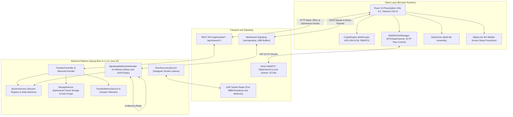
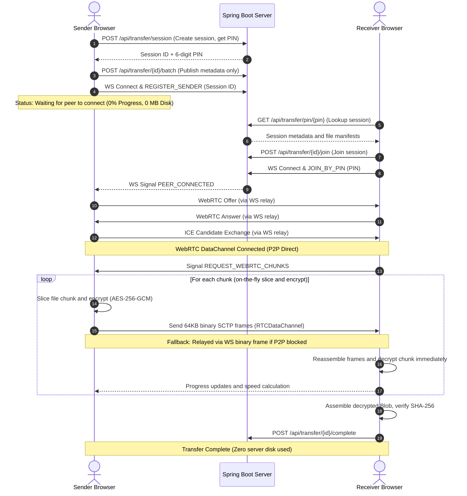
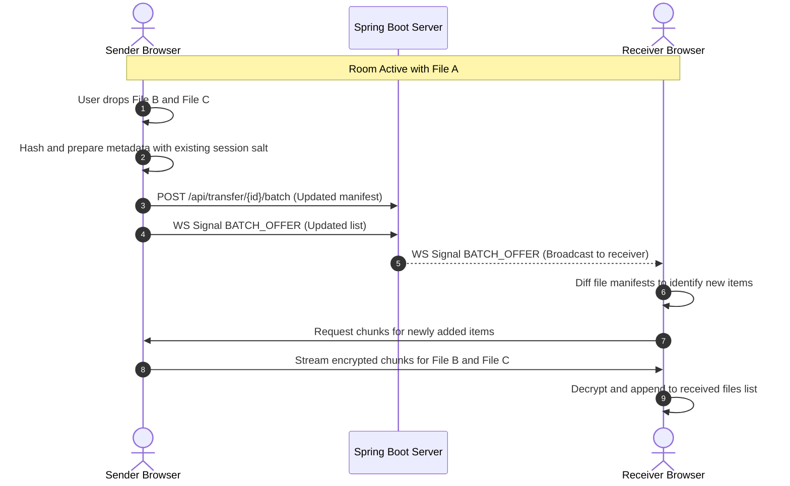
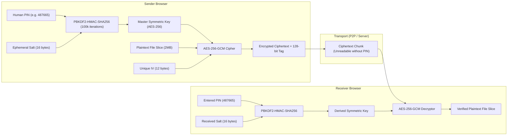

# W2W Share — High-Performance Encrypted Peer-to-Peer Transfer Engine

> 100% Offline Capable | Zero Internet Required | WebRTC Direct P2P | Client-Side AES-256-GCM | Subnet Peer Radar | Spring Boot 4.1.0 (Java 25) | React 19 + TypeScript + Vite

---

## Table of Contents

- [Overview](#overview)
- [Core Architecture](#core-architecture)
- [System Design and Data Flows](#system-design-and-data-flows)
  - [Live Direct Transfer Mode (Zero Server Storage)](#1-live-direct-transfer-mode-zero-server-storage)
  - [7-Day Server Vault Mode (Asynchronous Pickup)](#2-7-day-server-vault-mode-asynchronous-pickup)
  - [Dynamic Live File Ingestion](#3-dynamic-live-file-ingestion)
  - [Live WebRTC Screen Casting](#4-live-webrtc-screen-casting)
- [Cryptographic and Security Model](#cryptographic-and-security-model)
- [Transport Engine and Protocol Specifications](#transport-engine-and-protocol-specifications)
- [Subnet Peer Radar (UDP Discovery)](#subnet-peer-radar-udp-discovery)
- [Mobile and Web App Optimizations](#mobile-and-web-app-optimizations)
- [API and Signaling Protocol Reference](#api-and-signaling-protocol-reference)
- [Technology Stack](#technology-stack)
- [Quick Start and Installation](#quick-start-and-installation)
- [Deployment and Cloud Keep-Alive](#deployment-and-cloud-keep-alive)
- [Verification and Test Suite](#verification-and-test-suite)
- [License](#license)

---

## Overview

W2W Share is a privacy-first, zero-knowledge, high-throughput file, folder, screen, and message transmission platform. Designed for local Wi-Fi networks, air-gapped subnets, campus LANs, mobile hotspots, and cloud deployments, W2W Share delivers military-grade confidentiality without requiring third-party cloud accounts or public internet access.

### Fundamental Capabilities

1. **Zero Server Storage in Live Mode**: Files are sliced, authenticated, and encrypted entirely inside the sender browser. Chunks stream directly to the receiver over WebRTC RTCDataChannel or in-memory WebSocket binary relay without touching server disk storage.
2. **End-to-End Authenticated Encryption (E2EE)**: Every payload is protected using PBKDF2 with 100,000 iterations for key derivation and AES-256-GCM with unique 12-byte initialization vectors per chunk and 128-bit authentication tags.
3. **Dual-Transport Streaming Engine**: Uses 64KB SCTP packet slicing with event-driven backpressure over WebRTC DataChannel, with automatic fallback to in-memory WebSocket binary routing.
4. **Subnet Peer Radar**: Automatic local network discovery broadcasting beacon datagrams over UDP port 8888 across all physical and virtual network interfaces.
5. **Live Sharing Room**: Dynamically drop new files and directories into an open room without tearing down session credentials or regenerating PINs.
6. **WebRTC Screen Casting**: Native low-latency display sharing streamed directly between peers using display capture APIs.
7. **Burn-After-Reading & Auto-Purge**: Ephemeral sessions auto-destruct immediately after first download or upon preset expiration windows.

---

## Core Architecture

W2W Share uses a decoupled client-server architecture adhering to SOLID design principles and separation of concerns.



### Architectural Responsibilities

- **Frontend Application**:
  - Slices files into optimal chunk sizes (typically 2MB).
  - Derives cryptographic keys from a human-readable 6-digit PIN and ephemeral salt.
  - Slices encrypted chunks into 64KB SCTP frames with 10-byte binary headers.
  - Manages peer signaling state machine, flow control, and dynamic DOM assembly.
- **Backend Application**:
  - Coordinates room signaling (SDP offer/answer, ICE candidates, room membership).
  - Routes in-memory binary frames when WebRTC direct connection is hindered by NAT/firewalls.
  - Manages session lifecycle, expiration scheduling, and ephemeral storage purges.
  - Broadcasts network interface availability and UDP peer beacons.

---

## System Design and Data Flows

### 1. Live Direct Transfer Mode (Zero Server Storage)

In live mode, file data remains strictly on the sender machine. The server only holds lightweight session metadata (file names, sizes, chunk counts, salts, and authentication hashes). Chunks are transmitted on the fly only after the receiver claims the session.



### 2. 7-Day Server Vault Mode (Asynchronous Pickup)

For asynchronous transfers where sender and receiver cannot remain online simultaneously, the user can toggle "7-Day Vault". In this mode:

1. The sender browser encrypts all chunks client-side with AES-256-GCM.
2. Encrypted chunks upload to the server's ephemeral storage directory via `POST /api/transfer/{id}/chunk`.
3. The server stores only ciphertext; it never has access to the derived key or plaintext.
4. When the receiver connects at any point within the expiration window (up to 7 days), chunks download via `GET /api/transfer/{id}/chunk/{fIdx}/{cIdx}` and decrypt in the receiver browser.
5. If Burn-After-Reading is enabled, the storage directory and session purge immediately upon first download completion.

### 3. Dynamic Live File Ingestion

W2W Share allows senders to add files or directories to an already established PIN room without restarting the session:



### 4. Live WebRTC Screen Casting

Senders can stream their desktop or application window live to connected receivers:

1. Sender clicks "Share Screen" which invokes `navigator.mediaDevices.getDisplayMedia`.
2. The video track is added to the active `RTCPeerConnection`.
3. A renegotiation offer is transmitted across the signaling channel.
4. The receiver browser mounts the incoming `MediaStream` into the integrated `<LiveScreenViewer />` component with fullscreen controls and frame rate display.
5. When screen sharing terminates, a `SCREEN_SHARE_STOP` frame resets the interface automatically.

---

## Cryptographic and Security Model

W2W Share implements a zero-knowledge security boundary. The server acts strictly as an unauthenticated transport medium and never possesses credentials, keys, or plaintext data.



### Cryptographic Invariants

1. **Key Derivation Function**:
   $$\text{Key} = \text{PBKDF2}(\text{HMAC-SHA256}, \text{PIN}, \text{Salt}_{16}, 100000, 256)$$
   Resistant against offline dictionary attacks through high iteration counts and unique salts.
2. **Authenticated Encryption with Associated Data (AEAD)**:
   $$\text{Ciphertext}, \text{Tag}_{128} = \text{AES-GCM}(\text{Key}, \text{IV}_{12}, \text{Plaintext Chunk})$$
   Guarantees both confidentiality and integrity. If a single bit in the chunk or header is modified in transit, authentication fails and the chunk is discarded.
3. **Chunk Level Random IVs**:
   Each individual chunk is encrypted with a distinct cryptographically random 12-byte initialization vector (`crypto.getRandomValues`). IVs are never reused across chunks.
4. **End-to-End Hash Verification**:
   Before transmission, senders calculate full-file SHA-256 checksums. Upon reassembly, receivers verify the resulting Blob against the published hash to guarantee bit-for-bit authenticity.
5. **Key Disposal**:
   Cryptographic keys reside only in volatile JavaScript memory (`CryptoKey` object). When the session completes or tab closes, references are cleared and garbage-collected.

---

## Transport Engine and Protocol Specifications

### 1. WebRTC RTCDataChannel Engine

- **Channel Configuration**:
  - `ordered: true`
  - `binaryType: 'arraybuffer'`
- **Packet Structure (10-Byte SCTP Binary Header)**:
  ```
  0                   1                   2                   3
  0 1 2 3 4 5 6 7 8 9 0 1 2 3 4 5 6 7 8 9 0 1 2 3 4 5 6 7 8 9 0 1
  +-+-+-+-+-+-+-+-+-+-+-+-+-+-+-+-+-+-+-+-+-+-+-+-+-+-+-+-+-+-+-+-+
  |       File Index (uint16)     |      Chunk Index (uint32)     |
  +-+-+-+-+-+-+-+-+-+-+-+-+-+-+-+-+-+-+-+-+-+-+-+-+-+-+-+-+-+-+-+-+
  |     Packet Index (uint16)     |      Total Packets (uint16)   |
  +-+-+-+-+-+-+-+-+-+-+-+-+-+-+-+-+-+-+-+-+-+-+-+-+-+-+-+-+-+-+-+-+
  |                       Payload Data ...                        |
  +-+-+-+-+-+-+-+-+-+-+-+-+-+-+-+-+-+-+-+-+-+-+-+-+-+-+-+-+-+-+-+-+
  ```
- **Packet Sizing**: Max packet size is 65,536 bytes (64KB safe SCTP boundary). Payload per packet is 65,526 bytes.
- **Event-Driven Backpressure Flow Control**:
  - High water mark: 1MB (`HIGH_WATER_MARK = 1024 * 1024`)
  - Low water mark: 256KB (`LOW_WATER_MARK = 256 * 1024`)
  - When `dataChannel.bufferedAmount` exceeds the high water mark, sending workers await `waitForBufferDrain()` which hooks `bufferedAmountLowThreshold` and resolves synchronously when the buffer empties.

### 2. In-Memory WebSocket Binary Relay (Fallback)

If WebRTC connections cannot be established due to symmetric NAT, carrier-grade NAT (CGNAT), or enterprise firewall rules:
- Sockets configure `ws.binaryType = 'arraybuffer'`.
- The exact same 10-byte binary packets are transmitted over the signaling WebSocket.
- The backend handler (`SignalingWebSocketHandler.java`) receives binary messages in memory and forwards them directly to connected room peers without writing to disk or copying payload bytes into intermediate collections.
- `SignalingWebSocketHandler` configures 1MB message buffer limits to prevent frame truncation errors.

### 3. Immediate Waiter Resolution Architecture

In [`ReceivePanel.tsx`](file:///d:/W2WShare/frontend/src/components/w2w/ReceivePanel.tsx), chunks are requested by concurrent worker loops. Incoming chunks from either WebRTC or WebSocket binary streams immediately check `chunkWaitersRef`. If a download worker is waiting for that `${fIdx}-${cIdx}` key, the waiting promise resolves instantaneously, avoiding unnecessary polling or timeout intervals.

---

## Subnet Peer Radar (UDP Discovery)

W2W Share includes an autonomous local peer radar implemented in `PeerDiscoveryService.java`:

- **Broadcast & Multicast Ports**: Port `8888`
- **Multicast Group**: `224.0.0.251` (mDNS compatible subnet group)
- **Beacon Protocol**:
  ```json
  {
    "type": "W2W_BEACON",
    "deviceId": "workstation-5a12",
    "deviceName": "MacBook-Pro-LAN",
    "ip": "192.168.1.42",
    "port": 8080,
    "timestamp": 1774028400000
  }
  ```
- **Behavior**:
  - Broadcasts presence beacons every 5 seconds across all detected network interfaces (Wi-Fi, Ethernet, Hotspot).
  - Maintains an active in-memory table of local peers with 15-second TTL decay.
  - Allows receivers on the same network to detect and connect to senders with zero manual IP entry.

---

## Mobile and Web App Optimizations

1. **Screen WakeLock API**:
   Integrated via `useWakeLock.ts`. Automatically requests an active screen lock during active transfers to prevent mobile operating systems from suspending JavaScript execution when the display dims.
2. **Interactive 6-Cell Split PIN**:
   Custom numeric input boxes supporting auto-focus forward traversal, backspace back-tracking, and single-click clipboard code extraction.
3. **Deep-Link Auto-Claim**:
   Direct links containing `?pin=123456` or `?code=123456` auto-switch the UI to the receive tab, populate the PIN slots, and initiate the lookup and connection handshake with zero user input.
4. **Dynamic Mobile QR Scanner**:
   Generates pairing QR codes on the fly and integrates with the camera scanner to allow instantaneous mobile pairing.
5. **Touch Drag-and-Drop and Camera Input**:
   Mobile file inputs support direct photo capture (`capture="environment"`), image gallery selection, and folder directory uploads via `webkitdirectory`.

---

## API and Signaling Protocol Reference

### REST API Endpoints

| Method | Endpoint | Description |
|---|---|---|
| `POST` | `/api/transfer/session` | Create transfer session with expiration and burn-after-reading rules |
| `GET` | `/api/transfer/pin/{pin}` | Lookup session metadata by 6-digit numeric PIN |
| `POST` | `/api/transfer/{sessionId}/join` | Join session and acquire room membership |
| `POST` | `/api/transfer/{sessionId}/batch` | Register or update file batch metadata manifest |
| `POST` | `/api/transfer/{sessionId}/chunk` | Upload encrypted chunk (7-Day Vault / HTTP Relay fallback) |
| `GET` | `/api/transfer/{sessionId}/chunk/{fIdx}/{cIdx}` | Download encrypted chunk with range and retry support |
| `POST` | `/api/transfer/{sessionId}/complete` | Mark session completed (triggers burn-after-reading if enabled) |
| `DELETE` | `/api/transfer/{sessionId}` | Cancel and purge session storage and peer sockets |
| `GET` | `/api/network/interfaces` | List active local IPv4 network interfaces and URLs |
| `GET` | `/api/network/peers` | List live peers discovered via UDP Subnet Radar |
| `GET` | `/actuator/health` | System health check and storage capacity status |

### WebSocket Signaling Messages (`/ws/signaling`)

All text frames use JSON payloads:

```json
{
  "type": "SIGNAL_TYPE",
  "payload": { ... }
}
```

| Signal Type | Sender | Purpose |
|---|---|---|
| `REGISTER_SENDER` | Sender | Binds WebSocket connection to session ID as host |
| `JOIN_BY_PIN` | Receiver | Joins room using 6-digit PIN code |
| `PEER_CONNECTED` | Server | Notifies host that receiver has connected to room |
| `PEER_DISCONNECTED` | Server | Notifies host that receiver disconnected |
| `WEBRTC_OFFER` | Sender | Transmits SDP Offer to receiver |
| `WEBRTC_ANSWER` | Receiver | Transmits SDP Answer to sender |
| `WEBRTC_ICE_CANDIDATE` | Both | Exchanges ICE candidates for NAT traversal |
| `BATCH_OFFER` | Sender | Broadcasts updated file list dynamically |
| `REQUEST_WEBRTC_CHUNKS` | Receiver | Signals sender to begin streaming file slices |
| `RESEND_CHUNK` | Receiver | Requests selective retransmission of dropped chunk |
| `TEXT_MESSAGE` | Both | Relays instant encrypted note or clipboard text |
| `SCREEN_SHARE_START` | Sender | Notifies receiver that screen casting has started |
| `SCREEN_SHARE_STOP` | Sender | Notifies receiver that screen casting has ceased |

Raw binary frames (`ArrayBuffer`) sent to `/ws/signaling` are relayed immediately to room peers for zero-disk fallback transfers.

---

## Technology Stack

### Backend
- **Framework**: Spring Boot 4.1.0
- **Language**: Java 25 (Records, Pattern Matching, Virtual Threads)
- **Security**: Spring Security 7.x
- **Real-Time Communication**: Spring WebSocket (`AbstractWebSocketHandler`)
- **Persistence**: Ephemeral disk buffer, H2 in-memory database for metadata
- **Build Tool**: Apache Maven 3.9+
- **Quality Assurance**: JUnit 5, Mockito, AssertJ (80 automated tests)

### Frontend
- **Framework**: React 19
- **Build Tooling**: Vite 8.2 with Rolldown architecture
- **Language**: TypeScript 5.9
- **Styling**: Tailwind CSS 4
- **Icons**: Phosphor Icons React
- **Cryptography**: Web Cryptography API (`window.crypto.subtle`)
- **Transport**: WebRTC (`RTCPeerConnection`, `RTCDataChannel`), WebSocket API
- **Compression & Archiving**: `CompressionStream`, JSZip

---

## Quick Start and Installation

### Prerequisites
- Java Development Kit (JDK) 25 installed and configured on your `PATH`.
- Apache Maven 3.9+ installed.
- Node.js 20+ and npm installed.

### 1. Clone the Repository
```bash
git clone https://github.com/varunkushwah31/W2WShare.git
cd W2WShare
```

### 2. Run Backend Unit and Integration Tests
```bash
mvn test
```
All 80 tests should pass cleanly.

### 3. Start Backend Server
```bash
mvn spring-boot:run
```
The backend initializes on `http://localhost:8080`.

### 4. Start Frontend Development Server
In a separate terminal:
```bash
cd frontend
npm install
npm run dev
```
Open `http://localhost:5173` in your browser.

### 5. Build Standalone Production Executable
To package the entire application (including compiled frontend assets) into a single standalone JAR:
```bash
cd frontend
npm run build
cd ..
mvn clean package -DskipTests
java -jar target/w2w-share-1.0.0.jar
```
The complete app will be available on port `8080`.

---

## Deployment and Cloud Keep-Alive

W2W Share can run locally on private subnets or deployed to cloud platforms such as Render, Railway, or Fly.io.

### Keeping Free-Tier Backend Active

When deploying the backend on free cloud tiers (such as Render free tier which spins down after 15 minutes of inactivity), use the included automated GitHub Actions keep-alive workflow.

#### Automated GitHub Actions Ping Workflow

Located at `.github/workflows/keep-alive.yml`:
- Runs on a scheduled cron every 10 minutes (`*/10 * * * *`).
- Sends an HTTP GET request to `https://w2wshare.onrender.com/actuator/health`.
- Keeps the container active and prevents cold-start delays.

#### External Cronjob Alternative

You can also set up an external free monitoring ping:
1. Register on cron-job.org or UptimeRobot.
2. Create a monitor targeting:
   `https://w2wshare.onrender.com/actuator/health`
3. Set execution interval to 10 or 14 minutes.
4. Set HTTP method to `GET`.

---

## Verification and Test Suite

W2W Share includes an automated test suite covering controllers, cryptographic flows, session lifecycle, WebSocket handlers, and rate limiters.

Run the test suite:
```bash
mvn test
```

Expected result:
```text
[INFO] Results:
[INFO] 
[INFO] Tests run: 80, Failures: 0, Errors: 0, Skipped: 0
[INFO] 
[INFO] ------------------------------------------------------------------------
[INFO] BUILD SUCCESS
[INFO] ------------------------------------------------------------------------
```

Verify frontend build and type-checking:
```bash
cd frontend
npm run build
```

Expected result:
```text
> frontend@0.0.0 build
> tsc -b && vite build

vite building client environment for production...
built in ~1.9s with 0 errors.
```

---

## License

W2W Share is licensed under the Apache License, Version 2.0. See the `LICENSE` file for details.
